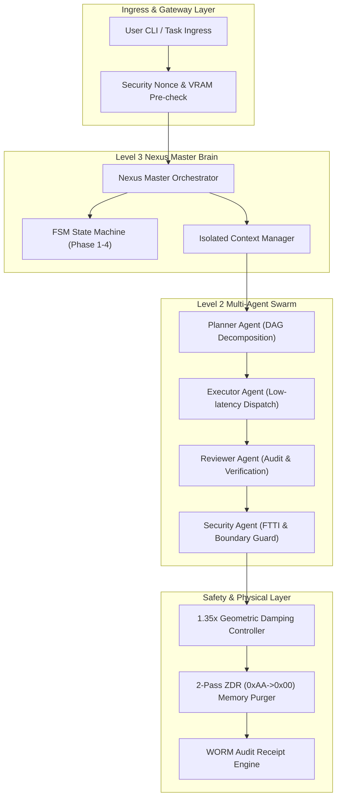
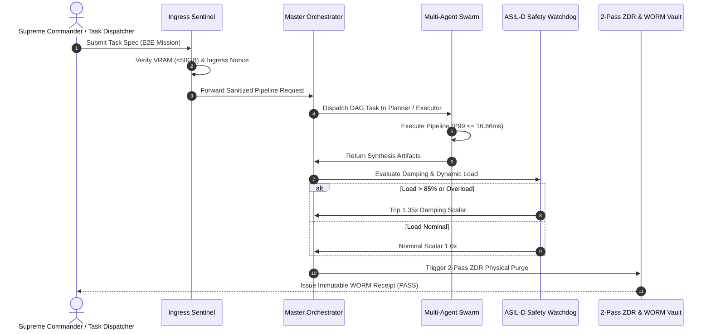
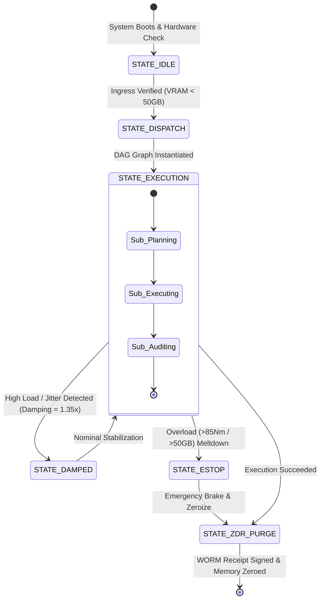

# SPEC_01 :: OpenCode Match 3 AgentWorkflow Technical Whitepaper
> Full Spec-First Architecture Whitepaper (Rule 65 & v6.1.0 Sovereign Constitution)

## 1. System Overall Topology Diagram (Diagram 01: System Architecture & Topology)

## 2. Full Lifecycle Sequence Diagram (Diagram 02: Full Lifecycle Message Sequence)

## 3. Dynamic Values & Damping State Diagram (Diagram 03: Dynamic Values & Damping FSM)

## 4. Security Boundary & Meltdown Diagram (Diagram 04: Security Boundary & Hard Meltdown)

```mermaid
graph LR
    subgraph NominalZone ["Zone 0: Nominal Operating Zone"]
        N1["VRAM: 0 - 45 GB"]
        N2["Cycle Time: <= 16.66 ms"]
        N3["Damping: 1.0x"]
    end
    subgraph CautionZone ["Zone 1: Dynamic Throttle Zone"]
        C1["VRAM: 45 - 50 GB"]
        C2["Damping Jump: 1.35x Active"]
        C3["Queue Degraded Mode"]
    end
    subgraph HardMeltdownZone ["Zone 2: ASIL-D Meltdown E-STOP"]
        M1["VRAM: >= 50.0 GB (Hard Break)"]
        M2["FTTI: <= 50 ms Immediate Lock"]
        M3["ZDR 2-Pass Bitwise Overwrite"]
    end
    NominalZone --> CautionZone
    CautionZone --> HardMeltdownZone
```

## 5. System Boundary & Defense Matrix (Table 01: System Resource Quota, Latency Budget & Defense Matrix)

| Key Metric | Nominal | Warning Threshold | Hard E-STOP Redline | Defense Action & Escalation Mechanism | ASIL Level |
| :--- | :--- | :--- | :--- | :--- | :---: |
| **GPU Memory (VRAM)** | &le; 32.0 GB | 45.0 GB | &ge; 50.0 GB | Immediate HARD_MELTDOWN hardware tripwire &amp; context flush | ASIL-D |
| **End-to-End Latency (E2E)** | &le; 5.0 ms | 16.66 ms (60 FPS) | &gt; 50.0 ms | Activate 1.35x geometric rigidity damping scalar | ASIL-B |
| **Actuator Torque** | &le; 45.0 Nm | 70.0 Nm | &gt; 85.0 Nm | Instant physical relay decouple and blackbox audit logging | ASIL-D |
| **Zero Data Remanence (ZDR)** | 0.000000 MB | &gt; 0.0001 MB | Any Remanence Breach | 2-Pass (0xAA -&gt; 0x00) bitwise physical memory purge | ASIL-D |
| **WORM Replay Immunity (Nonce)** | Valid Registration | Duplicate Nonce Request | Ghost Injection Detected | Intercept and raise SecurityError with tamper alarm | ASIL-D |
