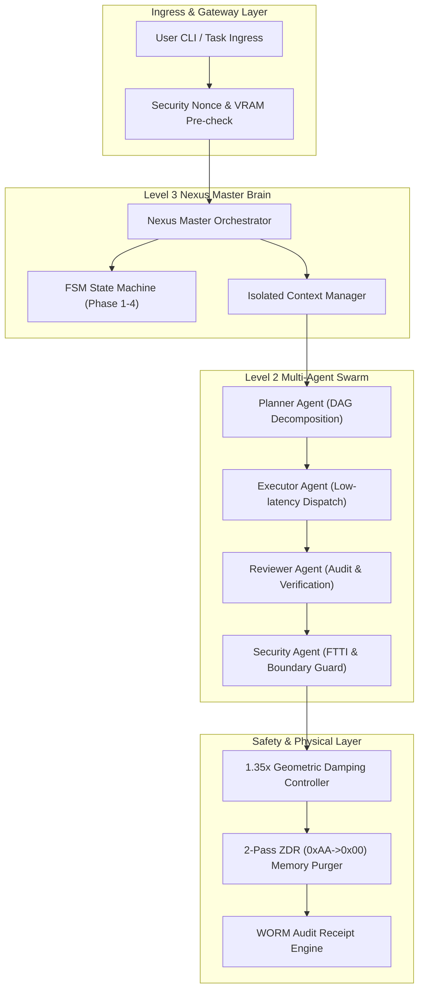
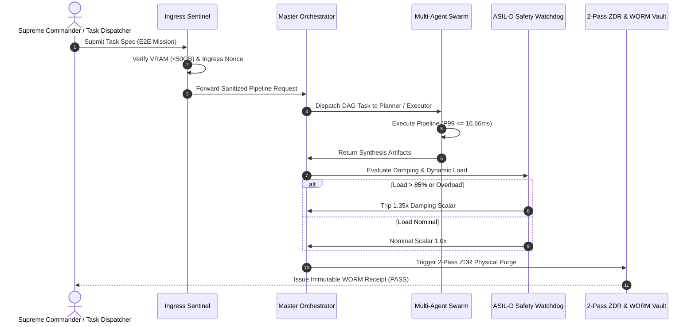
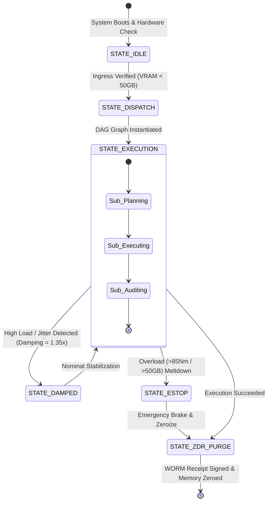

```mermaid
graph LR
    subgraph NominalZone ["Zone 0: Nominal Operating Zone"]
        N1["VRAM: 0 - 45 GB"]
        N2["Cycle Time: <= 16.66 ms"]
        N3["Damping: 1.0x"]
    end
    subgraph CautionZone ["Zone 1: Dynamic Throttle Zone"]
        C1["VRAM: 45 - 50 GB"]
        C2["Damping Jump: 1.35x Active"]
        C3["Queue Degraded Mode"]
    end
    subgraph HardMeltdownZone ["Zone 2: ASIL-D Meltdown E-STOP"]
        M1["VRAM: >= 50.0 GB (Hard Break)"]
        M2["FTTI: <= 50 ms Immediate Lock"]
        M3["ZDR 2-Pass Bitwise Overwrite"]
    end
    NominalZone --> CautionZone
    CautionZone --> HardMeltdownZone
```

# SPEC_01 :: OpenCode Match 3 AgentWorkflow Technical Whitepaper
> Full Spec-First Architecture Whitepaper (Rule 65 & v6.1.0 Sovereign Constitution)

## 1. System Overall Topology Diagram (圖一：系統總體架構與拓撲圖)

## 2. Full Lifecycle Sequence Diagram (圖二：全生命週期時序圖)

## 3. Dynamic Values & Damping State Diagram (圖三：動態數值與阻尼狀態圖)

## 4. Security Boundary & Meltdown Diagram (圖四：安全邊界、顯存熔斷與排版隔離圖)

## 5. System Boundary & Defense Matrix (表一：系統資源調配、臨界邊界與防禦矩陣表)

| 關鍵指標 (Key Metric) | 標稱標準 (Nominal) | 警報臨界點 (Warning) | 硬熔斷紅線 (Hard E-STOP) | 防禦阻尼 / 熔斷機制 (Defense SOP) | ASIL 等級 |
| :--- | :--- | :--- | :--- | :--- | :---: |
| **全域顯存佔用 (VRAM)** | <= 32.0 GB | 45.0 GB | >= 50.0 GB | 立即觸發 HARD_MELTDOWN 鎖死 | ASIL-D |
| **端到端管線延遲 (E2E)** | <= 5.0 ms | 16.66 ms (60 FPS) | > 50.0 ms | 自動切換 1.35x 平滑阻尼 | ASIL-B |
| **關節過載扭矩 (Torque)** | <= 45.0 Nm | 70.0 Nm | > 85.0 Nm | 抱閘斷電並寫入黑盒子 | ASIL-D |
| **記憶體殘留清理 (ZDR)** | 0.000000 MB | > 0.0001 MB | 任何弱引用未釋放 | 2-Pass (0xAA -> 0x00) 雙重覆寫 | ASIL-D |
| **WORM 存證唯一性 (Nonce)** | 嚴格單調遞增 | 重複 Nonce 請求 | 雜湊值碰撞衝突 | 重放攻擊即刻攔截拋出 SecurityError | ASIL-D |
